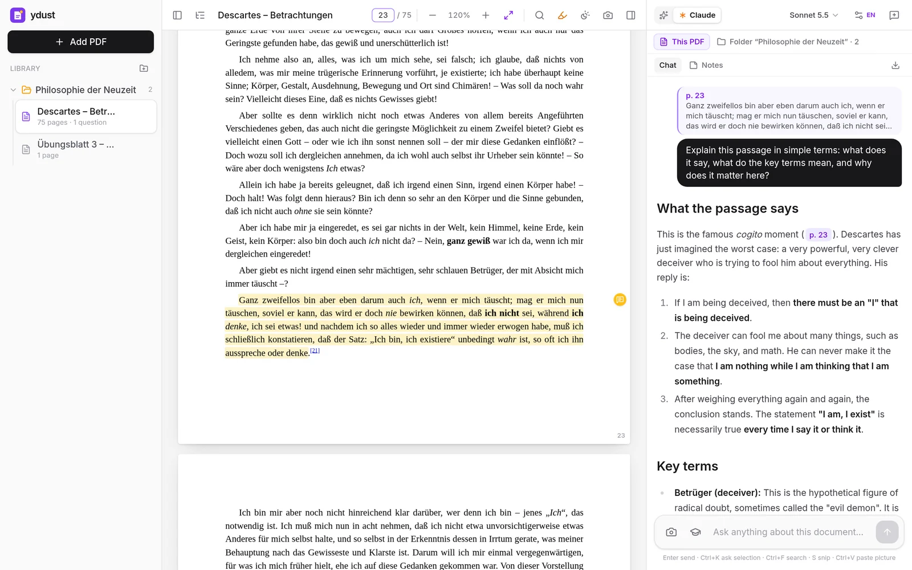
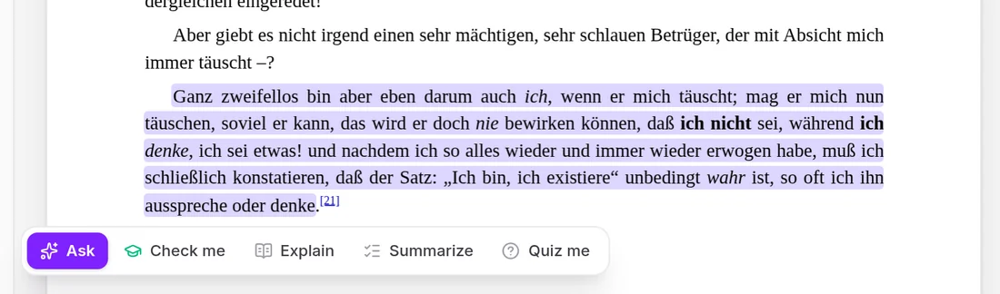
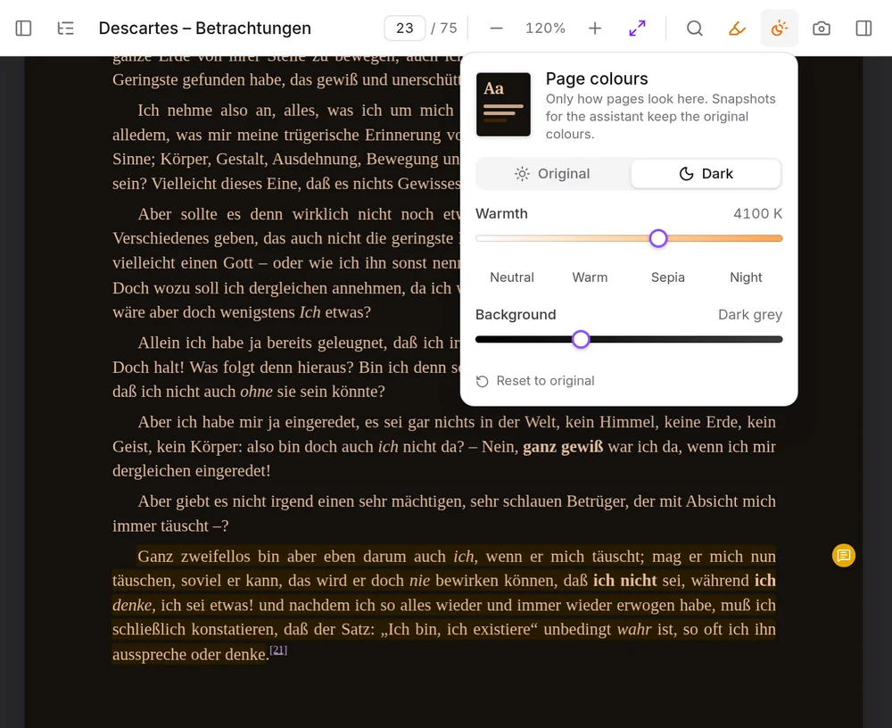
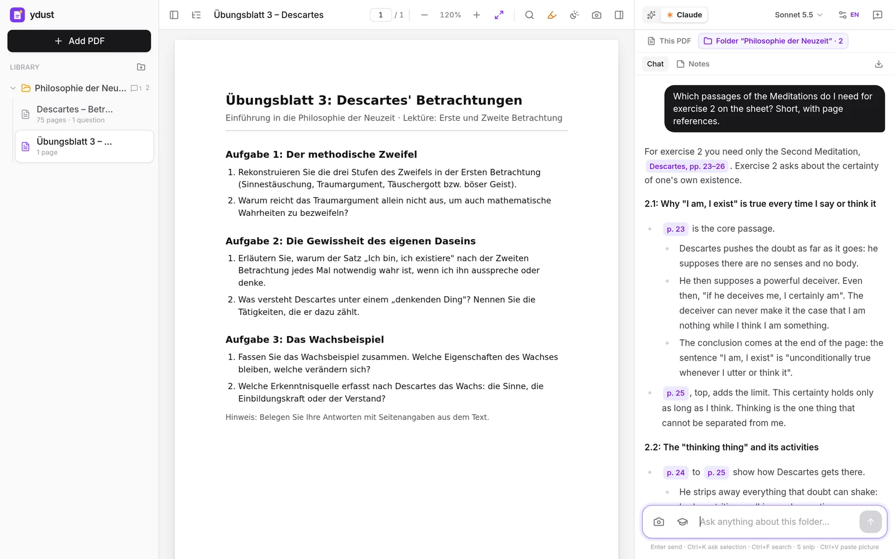

# ydust

**Study PDFs with an AI tutor next to you.** Open a PDF, select any passage, and ask about it. No copy-pasting. ydust runs locally and uses the AI command-line tools you already have: the **Antigravity CLI** (`agy`, Gemini) and/or **Claude Code** (`claude`).

> [!NOTE]
> **AI-coded.** This project was written with AI assistance. It was reviewed and tested to the best of my knowledge and belief, but comes without any warranty. See [Disclaimer](#disclaimer).



- [Features](#features)
- [Requirements](#requirements)
- [Installation](#installation)
- [Getting started](#getting-started)
- [Folders: study a whole course](#folders-study-a-whole-course)
- [Keyboard shortcuts](#keyboard-shortcuts)
- [Privacy and security](#privacy-and-security)
- [Configuration](#configuration)
- [Troubleshooting](#troubleshooting)
- [How it works](#how-it-works)
- [Limitations and ideas](#limitations-and-ideas)
- [Disclaimer](#disclaimer)
- [License](#license)

## Features

**Ask about what you read**



- **Select → Ask / Explain / Summarize / Quiz me**: a small menu appears where you finish selecting text. Selections work cleanly across lines and pages; double-click selects a word, triple-click a line.
- **Snip pictures**: press `S` (or the camera button) and drag a box over the page. The region is rendered sharply and attached to your question. Good for figures, formulas and scanned pages.
- **Paste pictures**: `Ctrl+V` a screenshot or photo into the chat.
- **Answers stream in** with Markdown, LaTeX math and clickable page citations (`p. 3`) that jump to the page.
- **The tutor knows the whole document**: it searches it and reads any page by itself, not just the passage you selected. Its search is as forgiving as yours (accents, `ß`/`ss`, hyphenation don't matter).

**Learn, don't just read**

- **Check my understanding**: select a passage → *Check me*, then explain it in your own words. You get feedback, hints and a follow-up question, not the full solution.
- **Explanation level**: Beginner, Student, Advanced or Exam prep.
- **Second opinion**: under every answer, *Ask Claude* / *Ask Antigravity* asks the other assistant the same question and lets it check the first answer.
- **Notes**: write your own Markdown notes next to the PDF, with formulas (`$x^2$`, `$$\int f$$`) and page links (`[p. 12](#page=12)`) that work in the preview. Every PDF and every folder has its own notes; they are plain `.md` files you can also open in any other editor. Notes save themselves as you type, and a note changed in another editor meanwhile is never overwritten without asking.
- **Add to note**: select a passage → *Notes* → *Add to note* quotes it with its page link (at the cursor, if a note is open). *Insert into note* under an answer adds the question, the passage and the answer.
- **The tutor writes into your notes, you decide**: ask for exercises, a summary or a cheat sheet "into a note" (or select a passage → *Notes* → *Write exercises* / *Summarize to note*). The assistant picks a fitting note or a new name, and you get a diff under the answer, like in git: *Accept* writes it and opens the note, *Request changes* gets a second version (the first stays one click away), *Discard* leaves no trace. Nothing is written without your click, and a note you changed meanwhile is never overwritten: the diff is shown again against your new text.
- **Pinned**: pin answers to the *Pinned* tab and add a comment to each. Export notes, pinned answers or the whole chat as Markdown.
- **Discussed passages**: passages you asked about are tinted in the PDF with a small bubble. Click it to jump to the answer; click a quote in the chat to jump to the passage.

**Study a whole course**

- **Folders** group PDFs that belong together (lecture notes, slides, exercise sheets, old exams).
- **Chat about one PDF or the whole folder**, with citations that open the right PDF at the right page. See [Folders](#folders-study-a-whole-course).

**Comfortable reading**

- **Search** (`Ctrl+F`) across *all* pages, with result list and highlights. Forgiving: umlauts/accents, `ß`/`ss`, line breaks and hyphenation don't matter (`satze` finds `Sätze`).
- **Table of contents** from the PDF's bookmarks, with the current chapter highlighted.
- **Page colours**: dark pages (black to dark grey background, light text), a warm tint from 6500 K down to 2500 K (presets *Warm*, *Sepia*, *Night*), and brightness, so white pages don't glare.

  

- Zoom, fit to width, page jump, remembers your last page, resizable chat, dark mode follows your system.

**Your choice of assistant**

- **Antigravity or Claude**, switchable at any time; the other assistant gets the conversation so far. Every answer shows who wrote it and (on hover) the exact model.
- **Model picker** with real model names, and the reasoning effort for Claude (`low` … `max`, or your Claude default).
- **Answer language** of your choice, or the language of your question.

## Requirements

- **Node.js 22 (LTS) or newer** recommended. It also runs on 20.19, but some dependencies officially require 22.
- **Linux, macOS or Windows.** Developed and tested on Linux. Windows is supported (CLIs installed as `.exe` or as npm `.cmd` shims both work) but hasn't been tested on a real Windows machine yet; feedback welcome.
- **At least one** of these AI command-line tools, installed and logged in:
  - **Antigravity CLI** (`agy`). Test it with `agy -p "hi"`.
  - **Claude Code** (`claude`). Test it with `claude -p "hi"`.

ydust uses your existing CLI login and subscription. There are no API keys to configure. A CLI that isn't installed is shown greyed out.

## Installation

```bash
git clone https://github.com/Cromewell/ydust.git
cd ydust
npm install
```

**Start (development):**

```bash
npm run dev
```

Then open <http://127.0.0.1:5173>.

**Start (single port, production build):**

```bash
npm run build
npm start
```

Then open <http://127.0.0.1:8787>.

**Tests:**

```bash
npm test          # once (npm run test:watch to rerun on changes)
npm run typecheck
```

The tests use [Vitest](https://vitest.dev) and need no AI CLI: they cover the forgiving text matching, the document tools (including the MCP server over stdio), the library store in a temporary folder, the prompts (as snapshots, in `test/__snapshots__/`) and the access checks of the API. After an intended prompt change, update the snapshots with `npx vitest run -u` and review the diff. CI runs typecheck, tests and build on Linux and Windows, with Node 22 and 20.19.

## Getting started

1. **Add a PDF**: click *Add PDF* or drag files into the window. ydust reads the text of every page in the background (shown as *Reading pages…*). Keep the tab open until it's done.
2. **Pick an assistant** at the top of the chat (Antigravity or Claude) and, if you like, a model.
3. **Select a passage** in the PDF and choose *Explain*, *Summarize*, *Quiz me*, *Check me*, or *Ask* to type your own question (`Ctrl+K` does the same).
4. **Or just ask** about the whole document in the chat, e.g. "Give me an overview of this document."
5. **Click page citations** in answers to jump there. **Pin** good answers (Pinned tab), or put them into a note.

Each PDF keeps its own conversation, also across restarts. *New chat* (top right of the chat) starts over.

## Folders: study a whole course

1. Click the **folder button** next to *Library* and name the folder (double-click renames it later).
2. **Drag PDFs onto the folder**, use the move button on a PDF, or drop new files straight onto the folder. A PDF can be in one folder at a time; deleting a folder keeps its PDFs.
3. When you open a PDF from a folder, the top of the chat lets you choose:
   - **This PDF**: the chat of this PDF. The tutor focuses on it, but may look into the folder's other documents when your question needs them.
   - **Folder**: one chat about all documents of the folder. Select passages in any of them. Answers cite pages in every document (e.g. *Script, p. 12*), and clicking a citation opens that PDF at that page.



To find the right places quickly, ydust gives the tutor a map of every document (its outline, from the PDF's bookmarks, or one heading per page for PDFs without them, e.g. slides) and two tools: a full-text **search** across the documents and **read_pages** for the exact text of a page range. The tutor then reads only the pages it needs.

## Keyboard shortcuts

| Key | Action |
| --- | --- |
| `Ctrl/Cmd + K` | Ask about the current selection |
| `Ctrl/Cmd + F` | Search in the document |
| `S` | Snip a region of the page (when not typing) |
| `Ctrl/Cmd + V` | Paste a picture into the chat |
| `Enter` / `Shift + Enter` | Send / new line |
| `Ctrl/Cmd + S` | Save the note now (in the note editor; it also saves by itself) |
| `Esc` | Cancel snipping, dismiss the selection, or remove the attached quote |

## Privacy and security

- **Your files stay on your computer.** PDFs, extracted text, chats and notes are stored in the `library/` folder next to the app.
- **But the AI runs in the cloud.** What you ask, and the parts of your documents the assistant reads, are sent to the provider of the CLI you use (Google for Antigravity, Anthropic for Claude), under your account and their terms. Don't use ydust for documents you may not share with them.
- **The assistant reads your documents and notes.** It can read the PDF's text (and, in a folder, the folder's other documents) and the chat's notes, nothing else on your computer. It cannot run commands or browse the web.
- **It can propose note drafts; nothing is saved until you accept the diff.** Its only way to write is ydust's `write_note` tool, which stores a draft for you to review. The CLIs' own write, command and web tools stay off.
  - Both get ydust's own tools (`search`, `read_pages`, `list_notes`, `read_note`, `write_note`), a small MCP server limited to the current chat's documents and notes; which ones is decided by ydust, not by the model. `write_note` hands the draft to ydust with a token that is only valid while that answer runs; ydust checks the name, size and mode, and only accepts a "replace" of a note the assistant has just read.
  - Claude Code only gets its read-only tools (`Read`, `Grep`, `Glob`) besides that; no other MCP servers.
  - Antigravity runs as a custom agent whose only built-in tool is `read_file`; writes, commands and URLs are additionally denied, and other MCP tools aren't approved.
  - Tests check that Claude is never given `Write`, `Edit`, `Bash`, `WebFetch` or `WebSearch`, and that Antigravity's settings still deny writing, commands and URLs.
- **Notes stay local** like everything else; the parts the assistant reads go to its provider, as above.
- **No remote pictures.** Answers and notes never load pictures from the web (an image address could carry text out); a picture shows as a label instead.
- **Local only.** The server listens on `127.0.0.1` and rejects requests from other websites, so a web page you visit can't use it through your browser. Keep it that way: the server drives an AI agent on your machine.

## Configuration

Set these environment variables before starting, e.g. `PORT=9000 npm start` (Linux/macOS), `$env:PORT=9000; npm start` (PowerShell) or `set PORT=9000 && npm start` (cmd).

| Variable | Default | Meaning |
| --- | --- | --- |
| `YDUST_LIBRARY` | `./library` | Where PDFs, chats and notes are stored |
| `PORT` | `8787` | Port of the server (the dev web server stays on `5173`) |
| `HOST` | `127.0.0.1` | Bind address. Keep it local (see [Privacy and security](#privacy-and-security)). |
| `AGY_BIN` | `agy` | Path to the Antigravity CLI |
| `CLAUDE_BIN` | `claude` | Path to the Claude Code CLI |
| `AGY_SETTINGS` | `~/.gemini/antigravity-cli/settings.json` | Where ydust reads Antigravity's default model |
| `CLAUDE_CONFIG_DIR` | `~/.claude` | Where ydust reads Claude's default effort |

Your preferences in the app (assistant, model, language, level, page colours, …) are remembered in the browser.

## Troubleshooting

- **An assistant is greyed out**: its CLI isn't found. Install it, log in, check that `agy -p "hi"` or `claude -p "hi"` works in a terminal, or set `AGY_BIN` / `CLAUDE_BIN` to its full path (on Windows e.g. `C:\Users\you\.local\bin\claude.exe` or `C:\Users\you\AppData\Roaming\npm\claude.cmd`). Then restart ydust.
- **"Could not continue the earlier conversation"**: the CLI's saved session is gone (e.g. after reinstalling it). Just ask again: a new session starts, with the chat so far as context.
- **I can't select text / the tutor can't read the PDF**: it's probably a scanned PDF without a text layer. Use snipping (`S`) to send pictures of the parts you're asking about.
- **Search finds nothing yet / answers ignore a document**: its text is still being read (*Reading pages…* in the sidebar). Keep the tab open until it's done.
- **Port already in use**: start with another port, e.g. `PORT=8790 npm start` (see [Configuration](#configuration) for Windows).
- **Antigravity seems to forget an older chat once**: after updating ydust, Antigravity chats from older versions start a new session once (the chat so far is handed over as context). That's expected.

## How it works

```
browser (React + pdf.js)  ──POST /api/…/ask──▶  Hono server (Node)  ──spawn──▶  agy / claude (headless, stream-json)
          ▲                                               │
          └────────── server-sent events (text, tool use) ◀┘
```

- **Text extraction** happens in the browser with pdf.js: every page goes to `document.txt` (hyphenated line breaks joined), the outline to `outline.txt`.
- **Each question** runs one headless turn of the selected CLI in the chat's folder (`library/<doc-id>/`, or `library/folders/<folder-id>/` for a folder chat). The other documents of the folder are added read-only with `--add-dir`. Sessions are resumed per CLI (`agy --conversation`, `claude --resume`).
- **ydust's tools**: for every question ydust starts a tiny MCP server (`server/mcp/search.ts`, stdio, no dependencies) limited to the chat's documents and notes. `search(query, doc?)` uses the same forgiving matching as the in-app search and returns pages with excerpts (falling back to pages that contain all words); `read_pages(doc?, from, to?)` returns the exact text of up to 10 pages (both only when a document has text). `list_notes()` and `read_note(name)` read the chat's notes. Claude Code gets the server via `--mcp-config` (only its tools pre-approved), Antigravity via `.agents/mcp_config.json` in the chat's folder (approved as `mcp(ydust/<tool>)`).
- **Drafts**: `write_note(name, content, mode, summary)` (mode `create`, `append` or `replace`) never touches the note. The MCP server posts the draft to `POST /api/internal/drafts` with the answer's turn token (32 random bytes, valid only while that answer runs; requests from a browser, which carry `Origin` or `Sec-Fetch-Site`, are refused). ydust stores it as `notes/.drafts/<id>.json` with a hash of the note it was made against, streams it to the browser, and records it on the answer. Accepting checks that the note is still the version the diff was shown against (otherwise the card shows the new diff), writes it atomically and removes the draft. *Request changes* is a normal question that carries the draft; the next `write_note` for that note becomes version 2. At most 20 drafts per chat (200 kB each) are kept; *New chat* removes open drafts, never notes.
- **Prompts and settings never go on the command line**: the prompt goes in on stdin, and JSON (settings, MCP config) as files in the chat's `.agents/` folder. That avoids command-line length limits and, on Windows, quoting problems with `.cmd` shims. CLIs are started with [cross-spawn](https://github.com/moxystudio/node-cross-spawn) (finds `.exe` / `.cmd` via `PATHEXT`), and stopping an answer ends the whole process tree (`taskkill /T` on Windows).
- **The prompt** contains the selected passage, the full text of that page, paths of attached pictures, the answer language and level, and your question. The first turn adds the tutor rules (cite pages as `[p. N](#page=N)`, …) and, in a folder, the list of documents with short ids (`d7`), text files and outlines. Other documents are cited as `[Name, p. N](#doc=d7&page=N)`. When a folder changes, the next turn tells the assistant what is in it now.
- **Switching assistants**: the other assistant gets the messages it hasn't seen yet as context.
- **Notes** are files in the chat's `notes/` folder, edited with CodeMirror and previewed with the same renderer as answers. Names are checked on the server (letters, digits, space, `.`, `_`, `-`, ending in `.md`, no paths, no names Windows reserves) and links aren't followed; a note is at most 1 MB, a chat has at most 200. Each save sends a hash of the version it started from: if the file changed in between (another tab, another editor), the server refuses with the current content and the editor asks which version to keep.

**Antigravity** is started like this:

```
agy --print= --input-format stream-json --output-format stream-json --disable-slash-commands \
    --agent ydust-tutor --settings .agents/agy-settings.json \
    [--add-dir <other doc folder> …] [--conversation <id>] [--model <model>]
    # stdin: {"event":"user","message":{"content":"<prompt>"}}
```

`agy-settings.json` contains the permissions:

```json
{ "permissions": {
    "allow": ["read_file(<chat folder>)", "read_file(<other doc folders>)", "mcp(ydust/search)", "mcp(ydust/read_pages)",
              "mcp(ydust/list_notes)", "mcp(ydust/read_note)", "mcp(ydust/write_note)"],
    "deny": ["write_file(*)", "command(*)", "read_url(*)", "execute_url(*)"] } }
```

ydust writes the custom agent to `.agents/agents/ydust-tutor.md` and the document tools to `.agents/mcp_config.json` in the chat's folder; the agent's only built-in tool is `read_file`. (agy's default agent could otherwise search the web, and `--mode plan` has no effect together with `--disable-slash-commands`.) A conversation keeps the agent it was started with.

**Claude Code** is started like this (prompt on stdin):

```
claude --print --output-format stream-json --verbose --include-partial-messages \
    --permission-mode default --tools Read Grep Glob \
    --strict-mcp-config [--mcp-config .agents/claude-mcp.json] \
    --allowedTools mcp__ydust__search mcp__ydust__read_pages mcp__ydust__list_notes mcp__ydust__read_note mcp__ydust__write_note \
    [--add-dir <other doc folder> …] [--resume <session-id>] [--model opus|sonnet|haiku] [--effort <level>]
```

Claude Code has no "list models" command, so ydust resolves its aliases (`opus`, `sonnet`, `haiku`, `fable`) by starting `claude` and reading the model from its first output line (cached for 30 minutes).

**Data layout** (in `library/`, or `YDUST_LIBRARY`):

```
library/
├── <doc-id>/
│   ├── document.pdf
│   ├── document.txt      text of every page ("=== Page N ===")
│   ├── outline.txt       bookmarks or page headings ("p. 12: Chapter 2")
│   ├── meta.json         name, chat history, one session id per CLI
│   ├── images/           pictures attached in this PDF's chat
│   ├── notes/            your notes for this PDF, plain Markdown (summary.md, …)
│   │   └── .drafts/      the assistant's drafts waiting for your review
│   └── .agents/          written by ydust for the CLIs: Antigravity's read-only agent, settings and
│                         document tools, Claude's MCP config
├── folders/<folder-id>/
│   ├── folder.json       name, member documents, the folder chat
│   ├── images/
│   ├── notes/            notes for the whole folder
│   └── .agents/
└── state.json            next short document id
```

## Limitations and ideas

- **Scanned PDFs** have no text layer: no text selection or search, and the tutor can't read them. Snipping works. OCR would help.
- **Dark pages** invert pictures too, so photos look like negatives.
- **Drafts** are accepted as a whole; accepting single hunks or editing a draft before accepting it would be nice. A chat writes only into its own notes (a folder chat into the folder's notes).
- Ideas: flashcard export; approving tool use from the UI via `agy acp` (Agent Client Protocol).

## Disclaimer

This project was **AI-coded**: written with AI assistance (Claude Code, with Gemini as a second reviewer). It was reviewed and tested to the best of my knowledge and belief. Still, it may contain bugs, and it comes **without any warranty**: use it at your own risk (see the [license](LICENSE)).

ydust is an independent project and not affiliated with or endorsed by Google or Anthropic. "Antigravity", "Gemini", "Claude" and "Claude Code" are names of their respective owners. Using their CLIs is subject to their terms.

AI answers can be wrong. Check important facts against your documents; that's what the page citations are for.

The screenshots show René Descartes, *Betrachtungen über die Grundlagen der Philosophie* (translated by Ludwig Fischer; public domain, from [Project Gutenberg](https://www.gutenberg.org/ebooks/27532)), and an exercise sheet written for them.

## License

[MIT](LICENSE)
